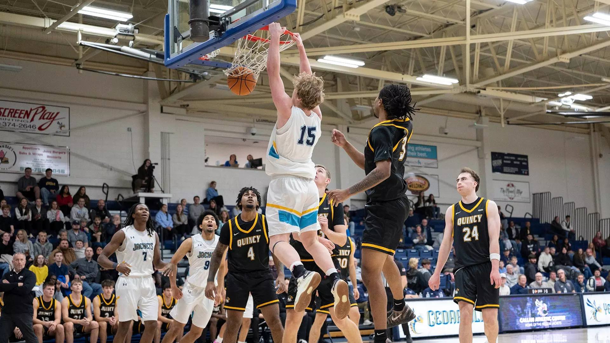
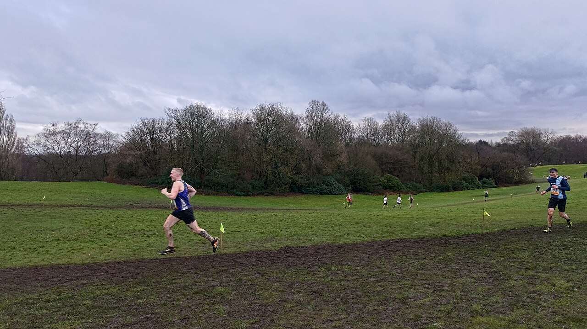
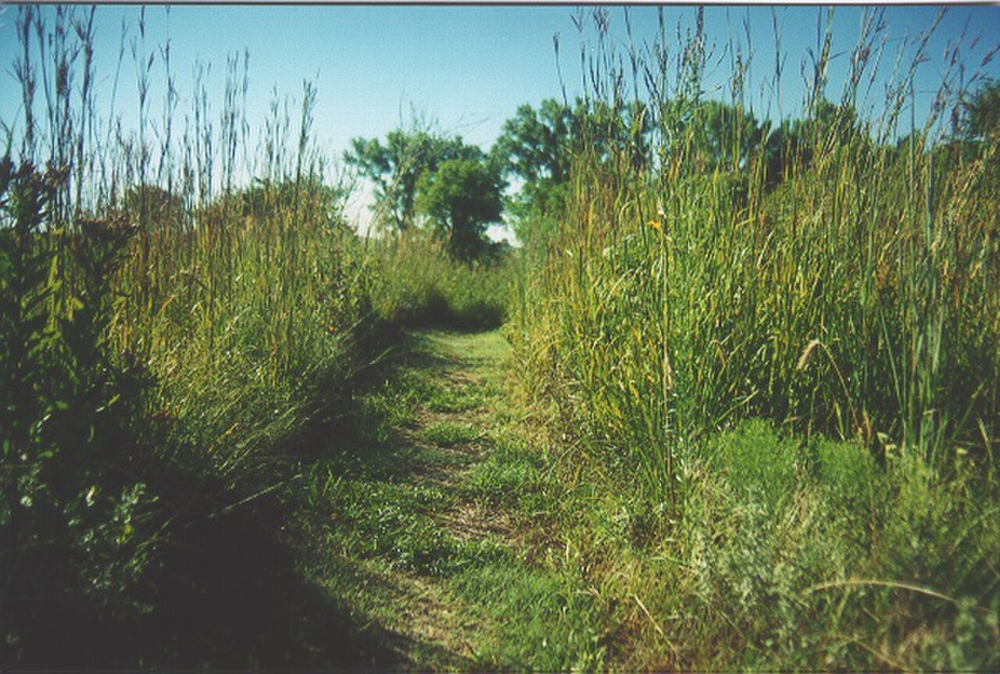
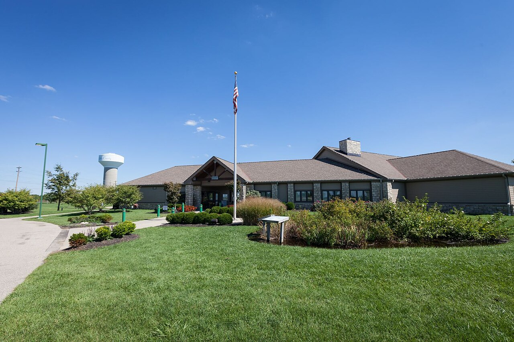
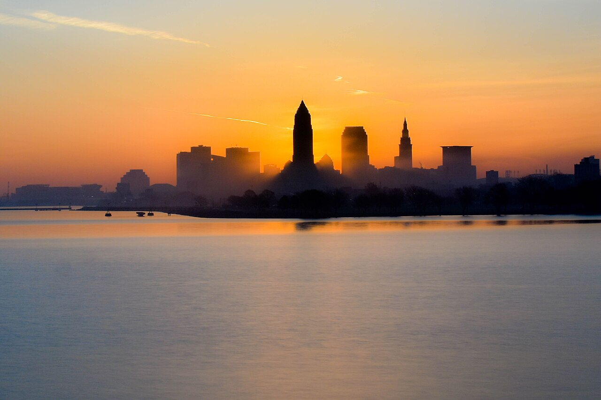
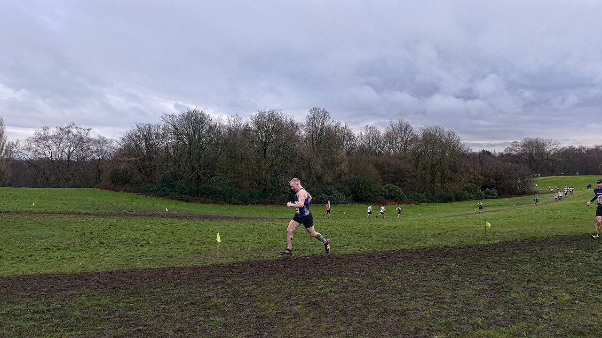
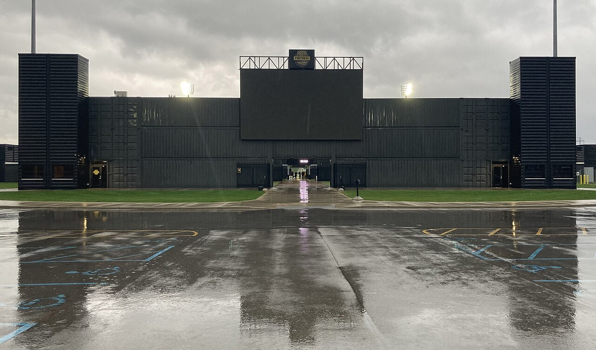
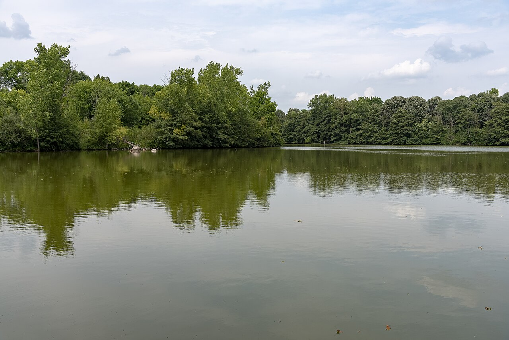
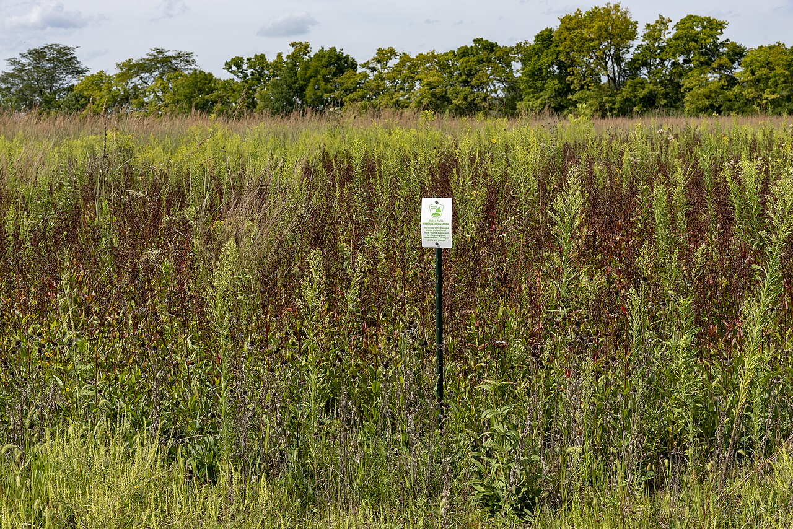
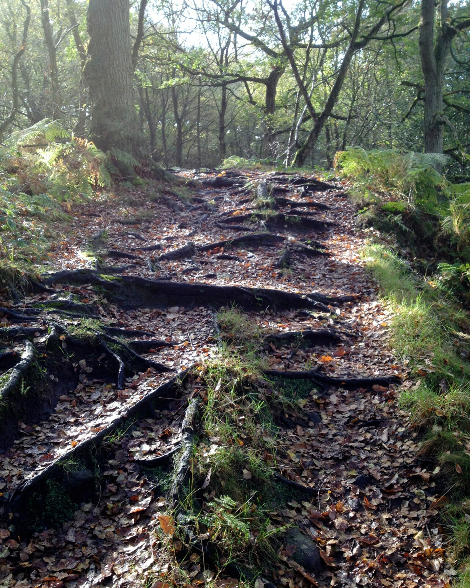

::: {.callout-caution}
## Caution
The images shown on this page are for reference only to illustrate what the course conditions and terrain would have been like on race day (e.g., muddy wooded trails, steep hill climbs, flat lakeside turf); they do not actually show that course.
:::

## Featured Ohio Cross Country Courses

Explore 10 distinct cross country courses across Ohio where high school athletes compete, featuring the runner, their recorded race time and year, and an example of the race conditions that day.

::: {layout="[1, 2]" layout-valign="center"}
{style="border-radius: 8px; width: 100%; box-shadow: 0 2px 6px rgba(0,0,0,0.1);"}

### 1. Cedarville University (Elvin R. King Course)
- **Runner:** Elias Bezy (Lehman Catholic)
- **Year:** 2018
- **5K Time:** 19:40
- **Course Conditions:** Rolling grass terrain with two gradual inclines; firm footing, open and breezy.

:::

---

::: {layout="[1, 2]" layout-valign="center"}
{style="border-radius: 8px; width: 100%; box-shadow: 0 2px 6px rgba(0,0,0,0.1);"}

### 2. Lorain County Community College Course
- **Runner:** Ryan Cummings (No. Olmsted)
- **Year:** 2016
- **5K Time:** 18:25
- **Course Conditions:** Wooded trails that turned slick and muddy after morning rain; tight turns through the trees.

:::

---

::: {layout="[1, 2]" layout-valign="center"}
{style="border-radius: 8px; width: 100%; box-shadow: 0 2px 6px rgba(0,0,0,0.1);"}

### 3. Battelle Darby Creek Metro Park
- **Runner:** Micaila Mountain (Grove City)
- **Year:** 2012
- **5K Time:** 22:56
- **Course Conditions:** Wide, flat prairie grass trails; dry, firm ground, flat and fast.

:::

---

::: {layout="[1, 2]" layout-valign="center"}
{style="border-radius: 8px; width: 100%; box-shadow: 0 2px 6px rgba(0,0,0,0.1);"}

### 4. Voice of America MetroPark
- **Runner:** Casey Murphy (Bellbrook)
- **Year:** 2015
- **5K Time:** 21:45
- **Course Conditions:** Manicured turf and gravel paths around the lake; wide-open, flat, and very fast.

:::

---

::: {layout="[1, 2]" layout-valign="center"}
{style="border-radius: 8px; width: 100%; box-shadow: 0 2px 6px rgba(0,0,0,0.1);"}

### 5. Edgewater Park (Cleveland Metroparks)
- **Runner:** Eliza Clark (Seven Hills)
- **Year:** 2013
- **5K Time:** 24:53
- **Course Conditions:** Open grassy hills along the lakefront; brisk headwinds off Lake Erie with firm turf footing.

:::

---

::: {layout="[1, 2]" layout-valign="center"}
{style="border-radius: 8px; width: 100%; box-shadow: 0 2px 6px rgba(0,0,0,0.1);"}

### 6. Hedges-Boyer Park (Tiffin)
- **Runner:** Mattie Lunceford (Plymouth)
- **Year:** 2012
- **5K Time:** 22:44
- **Course Conditions:** Historic hilly course featuring the steep "Beast" hill; soft turf with muddy footing near creek crossings.

:::

---

::: {layout="[1, 2]" layout-valign="center"}
{style="border-radius: 8px; width: 100%; box-shadow: 0 2px 6px rgba(0,0,0,0.1);"}

### 7. Fortress Obetz
- **Runner:** Ricky Dungan (Wilmington)
- **Year:** 2018
- **5K Time:** 18:23
- **Course Conditions:** Championship stadium course; wide spectator-lined straightaways, gravel mounds, and fast manicured turf.

:::

---

::: {layout="[1, 2]" layout-valign="center"}
{style="border-radius: 8px; width: 100%; box-shadow: 0 2px 6px rgba(0,0,0,0.1);"}

### 8. Sharon Woods Metro Park
- **Runner:** Ryan Cooper (Batavia)
- **Year:** 2014
- **5K Time:** 17:50
- **Course Conditions:** Scenic lakeside loop with gentle rolling hills; well-packed dirt and crushed gravel under crisp autumn skies.

:::

---

::: {layout="[1, 2]" layout-valign="center"}
{style="border-radius: 8px; width: 100%; box-shadow: 0 2px 6px rgba(0,0,0,0.1);"}

### 9. Scioto Grove Metro Park
- **Runner:** Kristina Nusbaum (Carey)
- **Year:** 2012
- **5K Time:** 22:13
- **Course Conditions:** Open savanna and river bluffs; uneven prairie grass paths with damp, soft turf in low sections.

:::

---

::: {layout="[1, 2]" layout-valign="center"}
{style="border-radius: 8px; width: 100%; box-shadow: 0 2px 6px rgba(0,0,0,0.1);"}

### 10. Blendon Woods Metro Park
- **Runner:** Natalie Fleming (Woodridge)
- **Year:** 2016
- **5K Time:** 19:29
- **Course Conditions:** Dense fall forest trails and rolling ravines; leaf-covered dirt paths with slick roots and tight turns.

:::
